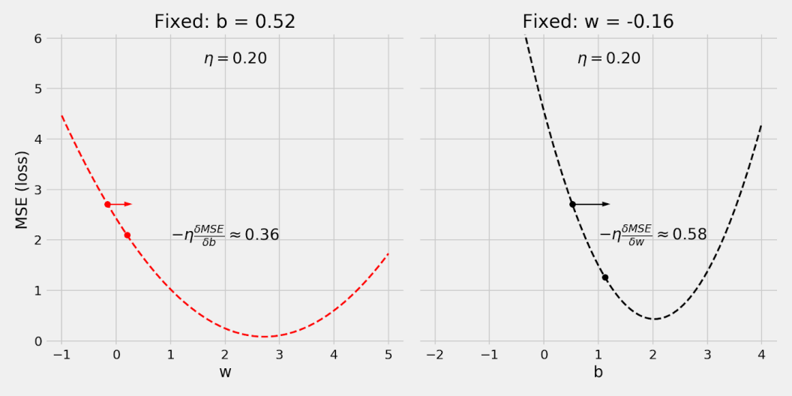
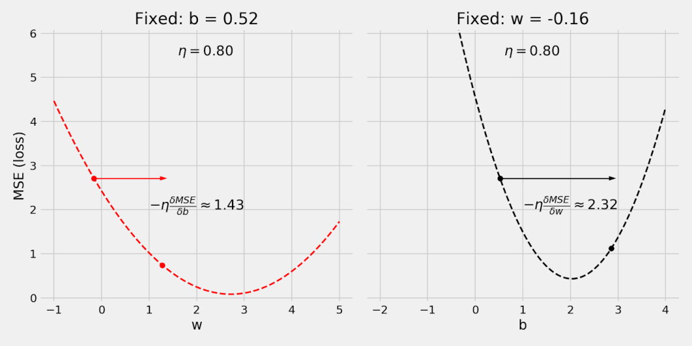
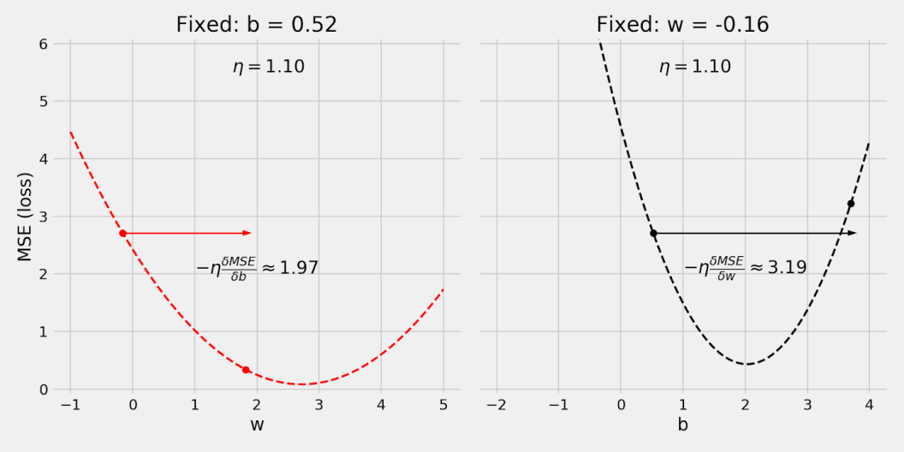

<!-- _class: lead -->
## Learning Rate

---

## 学习率

学习率是最重要的超参数。有大量资料介绍如何选择学习率、如何在训练过程中调整学习率，以及不合适的学习率会如何彻底毁掉模型训练。

story：
想象你在山里徒步返程，想要尽快回到家。走到路上某一处时，你可以选择继续直行或者右转。前方的道路几乎是平坦的，而右边的路有点陡峭。这个陡峭程度就相当于梯度。如果你朝其中一个方向迈出一步，会得到不一样的结果（相比直行，向右迈一步，下降幅度会更大）。

---

## 学习率

但事情是这样的：你知道右边这条路能让你更快到家，所以你不只是迈出一步，而是朝着这个方向连续迈出多步。你简直无法抗拒多走几步的冲动，步数越多，影响越大！为了尽快回家，你总是选择最陡的方向前进。你的行为似乎完全由地形决定。

不过，你仍然拥有一项选择权：你可以*调整步幅大小*。你可以选择任意大小的步子，从微小的碎步到大步跨跃。这就是学习率。

---

## 学习率

简单来说，你的移动方式是这样的：
```
更新后的位置 = 原有位置 + 步幅 × 步数
```
现在，把它和我们对参数的操作对比一下：
```
更新后的值 = 原有值 − 学习率 × 梯度
```

---

## 学习率

在这个场景下，沿着一个方向移动之后（比如刚才说到的向右走），你必须停下来，再朝另一个方向移动（只走一小步，别忘了，因为那段路几乎是平坦的）。如此反复。现实里应该没有人会沿着这种垂直交错的之字形山路徒步。

不管怎样，我们继续探讨你唯一能控制的选项：步幅——也就是学习率。

---
## 较小的学习率

可以从小步尝试开始，这就意味着要使用较小的学习率。较小的学习率相对更稳妥。假设你徒步返程回家时，只迈出极小的步子，你更有可能平安抵达目的地，但这会*耗费大量时间*。
训练模型也是同理：较小的学习率最终大概率能让模型收敛到某个极小值点。可惜时间就是成本，尤其是在云端按GPU时长计费时，因此会倾向于尝试更大的学习率。

---

## 较小的学习率

这套推理如何应用到我们的模型上？通过计算**几何梯度**，我们得到各自需要移动的步长：参数 w 为 1.79，参数 b 为 2.90。我们把学习率（步长系数）设为 0.2，算是偏小的值。这意味着参数 w 移动 0.36，参数 b 移动 0.58。

在真实场景中，0.2 的学习率通常**偏高**；但在我们这个极简线性回归示例里，它仍属于偏小水平。

这次参数更新会带来什么效果？如下图所示（原图中原始点右侧新增的点）：两种参数的更新都让损失更靠近最小值；右侧参数的改善幅度更大，因为对应的损失曲线更陡峭。

---

## 较小的学习率



---

## 较大的学习率



---

## 学习率

尽管左侧图像上一切尚且正常，但右侧图像呈现出完全不一样的情况：我们落到了曲线的另一侧。这可不是个好现象……模型会来回震荡，交替触及曲线的两侧。
“即便如此，我或许依旧能找到最小值，为什么情况会这么糟糕？”
在我们这个简单示例里，确实可以，最终能够找到最小值，因为这条曲线平滑规整。但在实际问题中，这类“曲线”的形态十分怪异，会出现各种反常结果，比如来回震荡，始终无法靠近最小值点。用这个类比来说，你的移动步长太大，一下子冲过谷底落到对面，之后就像乒乓球一样来回反弹。我知道这有点难以想象，但这绝对是需要避免的情况！

---

## 极大的学习率



---

## 极大的学习率

在右侧图像中，我们不仅再次落到了曲线的另一侧，而且实际上还向上爬升了。这意味着损失值非但没有下降，反而增大了！怎么会出现这种情况？下降的步幅太大，结果反而爬回去了？很可惜，这个类比已经无法继续帮我们理解了。我们需要换个思路来分析这个特例。

首先可以看到左侧图像的情况一切正常。即便学习率很大，也没有引发任何问题，原因是左侧曲线的坡度比右侧更平缓。换句话说，左侧曲线能够承受比右侧曲线更高的学习率。

---

## 小节

学习率“过高”是一个相对概念：它取决于曲线的陡峭程度，换句话说，取决于梯度的大小。我们会有很多条曲线、很多个梯度：每个参数对应一条曲线、一个梯度。但我们*只能选定唯一一个学习率*（没办法，现实就是如此！）。

这意味着学习率的取值受限于最陡峭的那条曲线。其余所有曲线都只能沿用这个学习率，也就是说，对于它们自身的形态而言，使用的并非最优学习率。

由此可以得出一个合理结论：如果所有曲线的陡峭程度都相同，那么这个学习率对所有曲线来说都会更接近最优值！