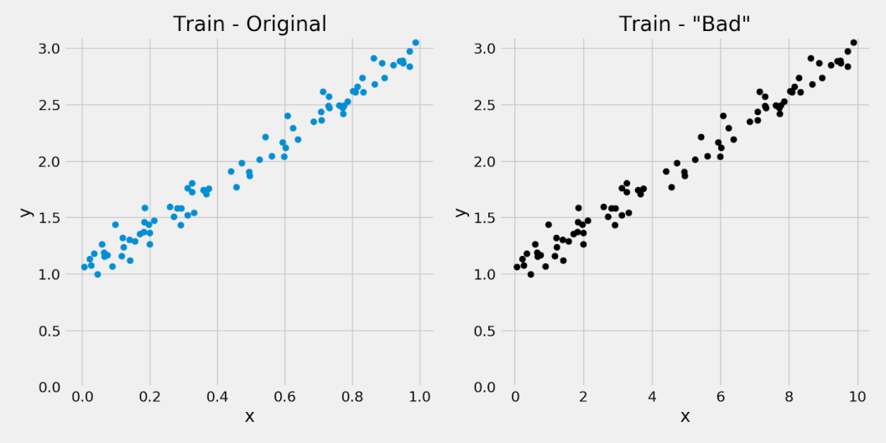
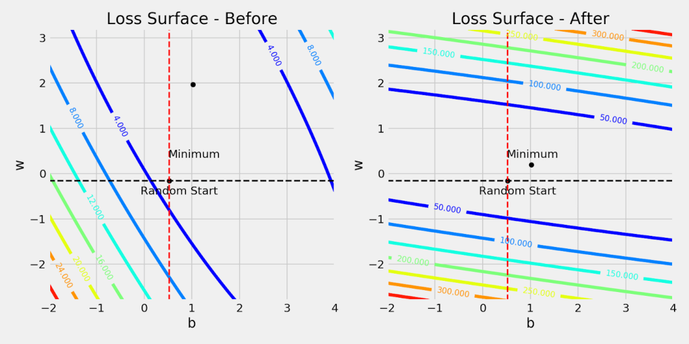
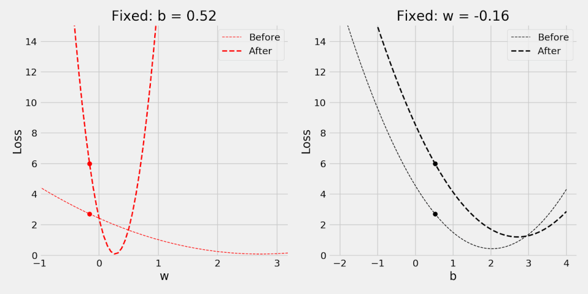
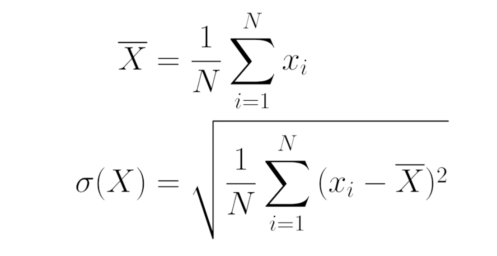
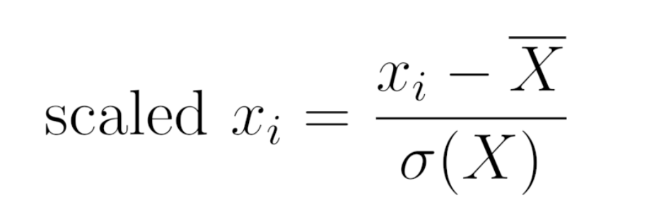

<!-- _class: lead -->
## Scaling / Standardizing / Normalizing

---

## Bad feature

*我们要如何得到同样陡峭的曲线？*
我们来看一个稍作修改的示例，我将其称为“坏”数据集：

-我把特征（x）乘以10，因此它现在的取值范围是[0, 10]，并将其重命名为bad_x。但由于我不想改变标签（y），我把原始真实权重参数true_w除以10，并将其重命名为bad_w——这样一来，bad_w * bad_x 和 w * x 的计算结果就保持一致。

---

## Bad feature

---

## loss

这两张图之间唯一的区别是特征x的尺度。它的取值范围原本是[0, 1]，现在变为[0, 10]。标签y没有发生变化，也没有改动true_b。*这种简单的缩放会对我们的梯度下降产生实质性影响吗？*

我们来计算新的损失曲面，并和之前的损失曲面做对比。

---

## loss

---

## loss

观察等值线数值：深蓝色线条原本为3.0，现在变成了50.0！在相同的参数取值范围内，损失值要高得多。

---

## loss

---

## loss

+ 红色曲线变得陡得多（梯度更大），因此我们必须使用更小的学习率，才能沿着曲线安全下降。

+ 更重要的是，红色曲线和黑色曲线之间的陡峭程度差异变大了。这正是*我们需要避免*的情况！因为学习率的取值受最陡峭曲线的限制！

+ 该如何解决这个问题？我们之前把数据放大10倍，从而造成了这个问题。如果换一种缩放方式，情况或许会有所改善。

---

## Scaling / Standardizing / Normalizing

有个很实用的工具叫做StandardScaler，它可以对特征进行变换，使得变换后的特征均值为0，标准差为1。

它是如何实现的？首先，它会利用训练集（共N个样本）计算给定特征（x）的均值和标准差：然后，它会使用这两个值对特征进行缩放：如果我们重新计算经过缩放后的特征的均值和标准差，得到的结果将分别为0和1。该预处理步骤通常被称作归一化，但严格来说，它应当被称为标准化。

---

## Scaling / Standardizing / Normalizing

---

## Scaling / Standardizing / Normalizing

> 重要提示：StandardScaler这类预处理操作*必须*在训练集、验证集、测试集划分完成之后执行；否则，会把验证集和（或）测试集的信息泄露给模型！
> 仅使用训练集对StandardScaler进行拟合之后，需要调用它的transform()方法，对全部数据集（训练集、验证集、测试集）执行该预处理操作。
> StandardScaler是`sklearn`的方法。pytorch没有类似的函数或者类