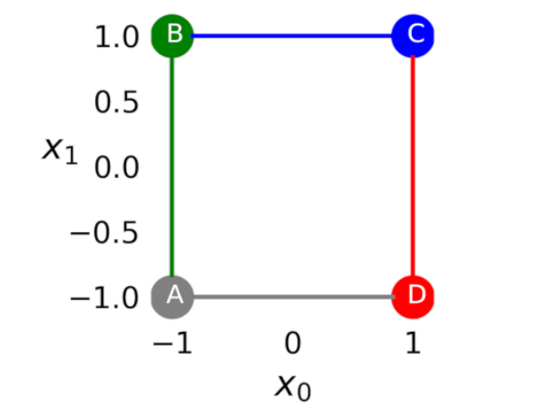
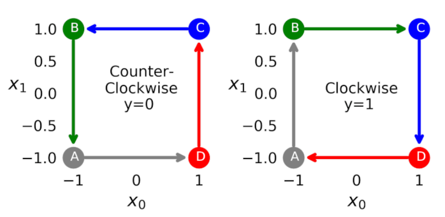
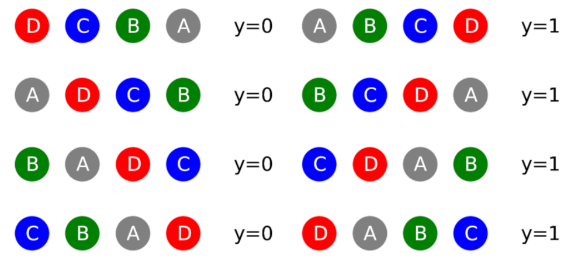
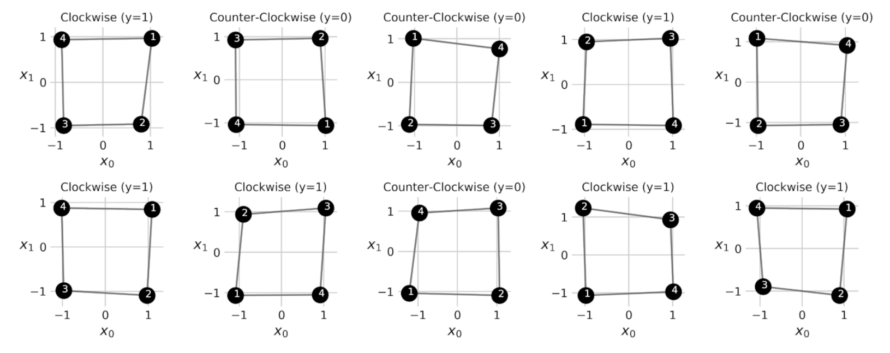

<!-- _class: lead -->
##  序列

---

### Sequences

+ 在序列问题中，一组有序的数据点共用同一个标签——重点在于*有序*。如果数据点没有顺序，即便它们共用同一个标签，这也不属于序列，而只是一组数据点的集合。
+ 像素被打乱的灰度图像。每个像素拥有一个数值，但单个像素没有标签。是这一组被打乱的像素，也就是这张打乱后的图像拥有标签：鸭子、狗或者猫（当然，标签是在像素打乱之前标注好的）。在打乱顺序之前，像素是有序的；也就是说，像素具备底层的二维结构。卷积神经网络可以利用这种结构：在图像上滑动的卷积核会观察中心像素，以及它在高度和宽度两个维度上所有相邻的像素。

---

### Sequences

+ 如果底层结构只有单一维度，那它就是序列。循环神经网络及其众多变体，还有一维卷积神经网络都可以利用这种特殊结构，序列问题主要分为两类：时间序列与自然语言处理（NLP）。
+ 我们会先构建一个合成数据集，再借助它讲解循环神经网络、编码器-解码器模型、注意力机制，甚至Transformer的内部原理。

---

### Data Generation

我们的数据点是二维的，因此可以可视化为图像，并且数据点是有序的，属于序列类型。我们将要绘制正方形！如下图所示，每个正方形都有四个角（显而易见！），每个角都分配了一个字母和一种颜色。左下角是A，为灰色；右下角是D，为红色，以此类推。

---

### Data Generation

四个角的坐标$(x_0,x_1)$就是我们的数据点。这个“理想”正方形的坐标如图所示：A=(-1, -1)，B=(-1, 1)，C=(1, 1)，D=(1,-1)。当然，我们会生成一个充满带噪声正方形的数据集，每个其顶点位于这些精准坐标周围。
现在，我们需要为每一组数据点（顶点）序列分配一个标签。假设你可以从任意一个顶点开始绘制正方形，并且绘图时铅笔不离开纸面，你可以选择顺时针或者逆时针绘制。这些就是我们所要的标签。

---
### Data Generation

---

### Data Generation

由于可以从四个角出发，并且有两个行进方向，因此实际上存在八种可能的序列。

---

### Data Generation

