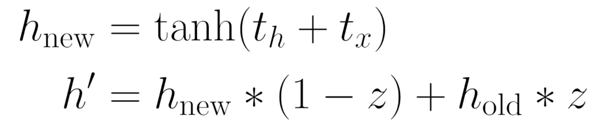
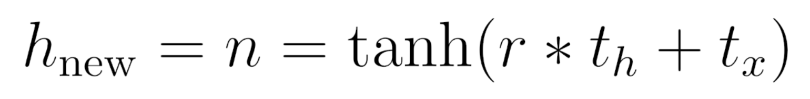
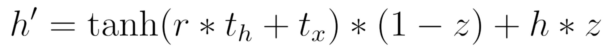
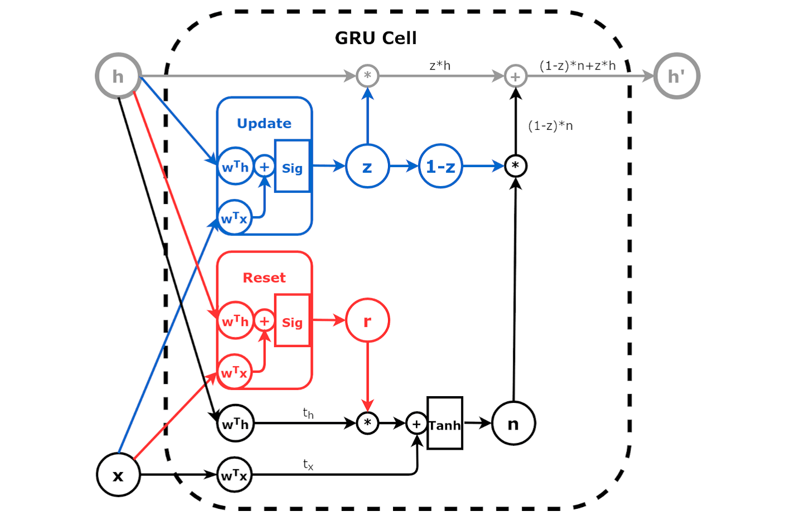
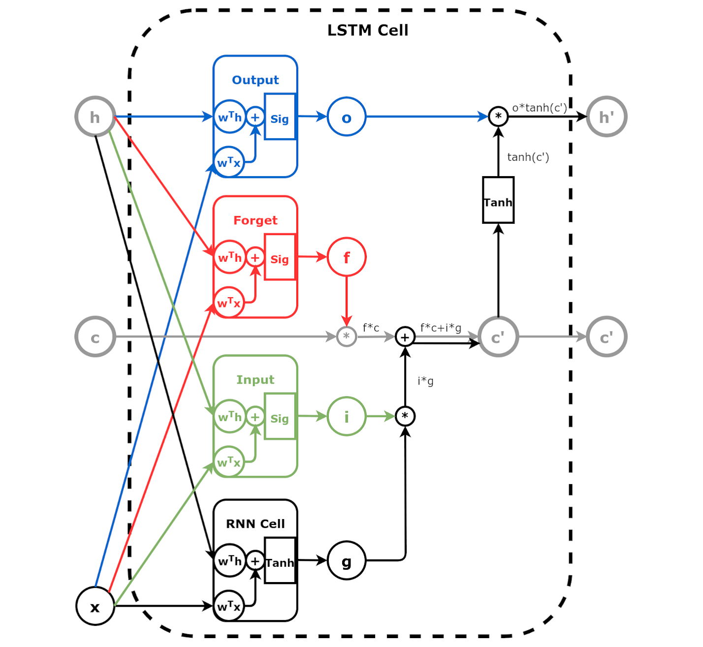

<!-- _class: lead -->

## RNN

---

##  循环神经网络层

nn.RNN层会帮我们处理隐藏状态，无论输入序列的长度是多少。这就是我们在模型中实际使用的层。
完整的循环神经网络还提供更多选项（例如堆叠层和/或双向层），同时在输入与输出的形状方面存在一个难点。

---

## arguments

+ input_size：指序列中每个数据点的特征数量。
+ hidden_size：指你想要使用的隐藏维度数量。
+ bias：和其他层一样，会在计算公式中包含偏置项。
+ nonlinearity：默认使用双曲正切函数，你也可以根据需要将其改为ReLU。

---

## arguments

循环神经网络（RNN）本身可以作为模型中的一层。但它自身可能包含内部层！可以通过以下四个额外参数对这些内部层进行配置：

+ num_layers：目前使用的循环神经网络只有一层（默认值），但如果你使用多层，就会构建出堆叠式循环神经网络。
+ bidirectional：到目前为止，我们的循环神经网络（RNN）都是按从左到右的方向处理序列（默认方式），但如果你将该参数设为True，就会创建一个双向循环神经网络。

---

## arguments

+ dropout：这会在循环神经网络（RNN）的内部层之间引入RNN自身的丢弃层，因此仅当使用堆叠式循环神经网络时，该设置才有意义。
+ batch_first：如果为 True，则输入和输出张量的格式为 (batch, seq, feature)”，这会让你以为只需将它设为 True，所有张量就会变成你熟悉的形式，不同批次拼接在第一维上 —— 但这个想法大错特错。
+ 只有输入张量和输出张量是批次优先格式；*隐藏状态永远不会是batch优先*格式。

---

## Shapes

### 输入：
输入张量包含想要送入循环神经网络（RNN）的序列：
+ 默认维度顺序为序列优先，即（序列长度，批次大小，特征数），简写为（L, N, F）。
+ 但如果开启 batch_first，前两个维度会互换，此时要求张量形状为（N, L, F），这也是从数据加载器中拿到数据时常见的形状。

---

## Shapes

初始隐藏状态，若未提供则默认为全零：
▪ 简单循环神经网络（RNN）的隐藏状态张量形状为 (1, N, H)。
▪ 堆叠循环神经网络的隐藏状态张量形状为 (堆叠层数, N, H)。
▪ 双向循环神经网络的隐藏状态张量形状为 (2×堆叠层数, N, H)。

---

## Shapes

### 输出：
+ 输出张量包含序列所有时间步下，循环神经网络单元输出所对应的隐藏状态：
+ 简单循环神经网络的输出张量形状为 (L, N, H)。双向循环神经网络的输出张量形状为 (L, N, 2*H)。
+ 若设置 batch_first，输出张量形状变为 (N, L, H)。
+ 表征整个序列的最终隐藏状态，其形状遵循与初始隐藏状态相同的规则。

---

## Can We Do Better?

+ 如果上一时刻的隐藏状态包含的信息比新计算出的隐藏状态更多，该怎么办？
+ 如果当前数据样本带来的信息多于上一时刻隐藏状态所携带的信息，该怎么办？

---

## Gated Recurrent Units (GRUs)

门控循环单元，简称GRU，正是这两个问题的解决方案！我们逐个分析问题，看看它是如何实现的。试想一下，如果我们不是简单地计算出新的隐藏状态并直接采用，而是对新旧两种隐藏状态做加

---

## Gated Recurrent Units (GRUs)

新参数z控制门控循环单元（GRU）对旧隐藏状态分配的权重大小。第一个问题已经解决，只需将z设为0，就能还原出循环神经网络（RNN）的典型行为。

---

## Gated Recurrent Units (GRUs)

新参数r用于控制在加入经过变换的输入之前，保留旧隐藏状态的比例。当r取值较小时，该数据点的相对重要性会提升，由此解决第二个问题。此外，只需将r设为1，就能还原出传统循环神经网络（RNN）的特性。这个新的隐藏状态被称为候选隐藏状态（n）。

---

## Gated Recurrent Units (GRUs)

+ 顺便一提，这两个新参数r和z被称为**门控单元**，分别是重置门和更新门。二者输出的值都必须介于0到1之间，因此只有原始值的一部分能够通过。
+ 每个门都会生成一组值向量（每个取值在0到1之间），向量的维度大小与隐藏维度的数量保持一致。例如，当存在两个隐藏维度时，某个门的取值可以是 [0.52, 0.87]。

---

## r and z

实际上会用一种基本等同于循环神经网络单元的结构来训练这两个门，唯一的区别是它使用sigmoid激活函数。
每一个名副其实、用于生成适配门控数值的函数门，都会使用取值介于0到1之间的Sigmoid激活函数。

---

## Gated Recurrent Units (GRUs)

---

## Long Short-Term Memory (LSTM)

